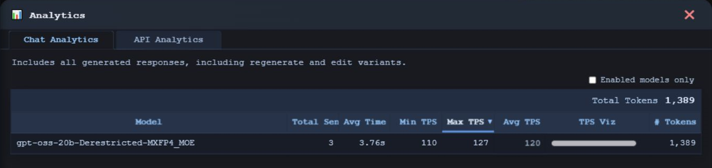
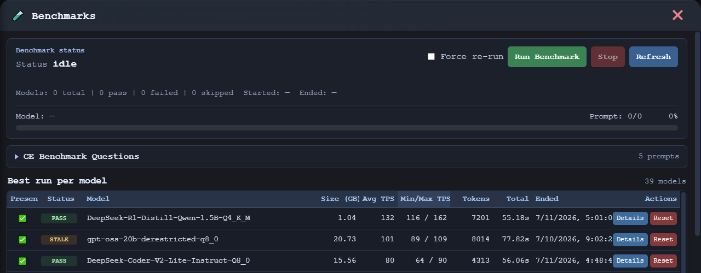
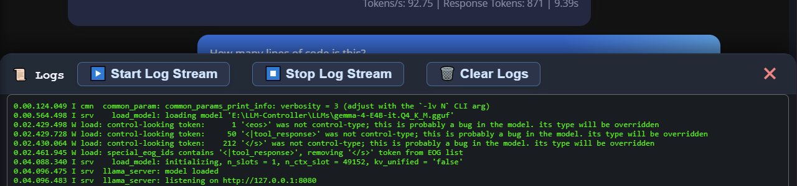
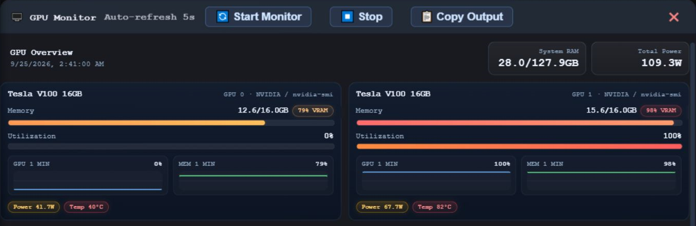

# Analytics and monitoring

[← Documentation](README.md) · [Models](MODELS.md) · [API](API.md)

See what CE has recorded and what the host is doing now. Usage analytics, benchmark results, runtime logs, and GPU telemetry answer different questions; none should be mistaken for a universal model-performance guarantee.

[Analytics](#analytics) · [API activity](#api-analytics) · [Benchmarks](#benchmarks) · [Logs](#runtime-logs) · [GPU and memory](#gpu-and-memory)

## Analytics

Use Analytics to review recorded activity and model-level usage and performance. Administrators can filter model rows to enabled models using the existing model-management state. This changes the visible model rows; **overall totals remain unchanged**.

A quiet or newly prepared installation may have little history. Missing measurements are not zero-performance results, and historical values do not establish what another host will achieve.

Use the model library's recorded **Max TPS** as an observed high-water mark. Benchmark results and everyday chat measurements may represent different workloads; retain that context when comparing them.

## API Analytics

API Analytics is **administrator-only**. It reports request counts, errors, durations, recorded token usage, and recent request metadata, with pagination for the request history.

**Avg Completion Time** includes only completed chat-completion events with an HTTP status below 400 and a recorded duration. Failed or cancelled completions and `/v1/models` requests do not belong in that average. Error and request counts remain separate measures.

Token usage is based on information reported by the backend. Do not substitute invented values when a runtime does not supply a measurement.

Request tracking stores operational metadata—not prompts, responses, image content, API keys, or authorization headers. This describes the request-tracking path; it is not a blanket statement about every log or independently configured proxy in a deployment.

[API setup, supported endpoints, and examples →](API.md)

## Benchmarks

Administrators run benchmarks from the existing Benchmark drawer. Choose a suite and profile beside **Run Benchmark**. Core Suite retains its five existing prompts, including operator customizations. The operator-seeded built-ins cover General Knowledge & Reasoning, Coding, Tool Calling, Writing & Summarization, and Performance Baseline.

**Manage Suites** creates custom suites, duplicates any revision, and edits ordered prompts, categories, token limits, and optional tool request JSON. Saving an edit creates a new immutable revision; previous prompts and results stay linked. Core remains editable through revisions. Other built-ins are read-only: duplicate them to customize. Archive removes a custom suite from new runs while preserving history. Management is locked during benchmarks; stale edits produce a conflict instead of overwriting newer work.

Results are scoped to the selected **revision and profile**. Use **Results for revision** and **Model run history** to inspect older revisions, archived suites, and previous attempts. Force re-run retains the existing behavior: completed execution attempts, including failures, otherwise count as already benchmarked. The separate model **Reset** action still clears that model's entire benchmark history across suites.

**Run passed** and **Request succeeded** describe execution, not answer quality. Completion is reported separately: answer completed, tool call returned, token limit, empty response, reasoning only, unknown, request/runtime failure, or cancellation. A normal completion does not verify factual accuracy. Token limits are capped by the selected profile; the effective limit and runtime settings appear in details.

Tool Calling sends actual function definitions and validates returned names, JSON arguments, required fields, types, enums and numeric bounds. It never executes tools or fetches their results. With `tool_choice=auto`, a text answer without a tool call is allowed. Whether a call meets the prompt's intent remains manual review. Support depends on the installed llama-server build and model template; backend rejection is a request failure. CE does not force new launch flags. Custom parameter schemas support explicit object, array, string, integer, number, boolean and null types, plus properties, required, boolean additionalProperties, items, enum, minimum, maximum, description and title; unsupported schema keywords are rejected visibly.

New token counts and generation/prompt-evaluation speeds use backend measurements when supplied. Missing values and nonstreaming TTFT are **Unavailable**. Request duration is measured locally and includes request overhead. Legacy request throughput and potentially estimated token counts remain readable in details but do not enter the new generation-speed ranking. Pre-migration runs lack frozen runtime settings and may reference prompts edited before migration; earlier overwritten text cannot be reconstructed.

**Copy Result**, **Copy Model Run**, and JSON/CSV exports include prompts, captured responses, reasoning/tool calls, completion details, metrics, errors, and available configuration. A model run contains one model's prompts; there is no multi-model batch export. CSV contains one row per prompt, blanks for unavailable values, and quoted multiline text. Formula-like text cells receive a protective apostrophe; JSON and clipboard text preserve the original strings. Prompts without persisted results are identified explicitly. Advanced details remain collapsed within the existing details view.

Benchmark eligibility stays in the model library. Speech checkpoints and projector assets are excluded. Running benchmarks stops the current main/title runtimes and cycles eligible models using the existing readiness and CPU fallback handling. Results depend on the host and workload; throughput is not an answer-quality score.

**Operator prerequisite:** before using Benchmarking v2, stop CE and complete the applicable [v1.5 upgrades](../INSTALL.md#v14-to-v15-upgrade), then apply the separately reviewed Benchmarking v2 schema migration and built-in suite seeds manually. The supplied `*_DRAFT.sql` handoff files require operator finalization; the current repository SQL is not updated by this application change. Fresh-install schema/seed integration is also an operator task. Do not run the general fresh-install seed on an existing database. Start the matching application only after the schema and seeds are ready.

## Runtime logs

Open **Logs** to inspect the relevant runtime. The **Language Model** and **Speech-to-Text** views use the same readable log presentation while keeping their output separate.

See runtime logs

For speech, the bounded log refreshes while its tab is active. The main CE console also mirrors lifecycle messages as `[S2T]` and child-process output as `[S2T runtime]`, including startup/import progress and readiness.

A process being launched is not the same as the runtime being ready. Check status and the actual error when a model fails to load. Missing dependencies, an occupied port, an incompatible file, and insufficient GPU memory need different remedies.

For speech-specific diagnosis, use the [voice troubleshooting guide](../VOICE_INSTALL.md#troubleshooting). For a language runtime, the installation guide includes a [direct, loopback-only troubleshooting example](../INSTALL.md#optional-troubleshooting-llama-server).

Keep private paths, personal content, and secrets out of public log screenshots and problem reports.

## GPU and memory

CE provides runtime/process visibility and system RAM used/total. The **GPU Monitor** supports NVIDIA and AMD telemetry paths when the appropriate local tools and drivers are available and compatible.

See the GPU Monitor

Relevant host tools include `nvidia-smi`, `rocm-smi`, and `rocminfo`. These are operator-installed dependencies, not software that CE installs for you.

Unavailable telemetry is not proof that inference failed, and available GPU telemetry does not establish that every runtime feature supports that GPU. In particular, the validated v1.4 voice path is Windows/NVIDIA CUDA; AMD telemetry is not an AMD speech-support claim.

Watch resource use alongside runtime errors when diagnosing capacity. Other workloads may occupy memory even when they were not started by CE.

---

[Model controls](MODELS.md) · [API integration](API.md) · [Administration and data](ADMIN.md)
